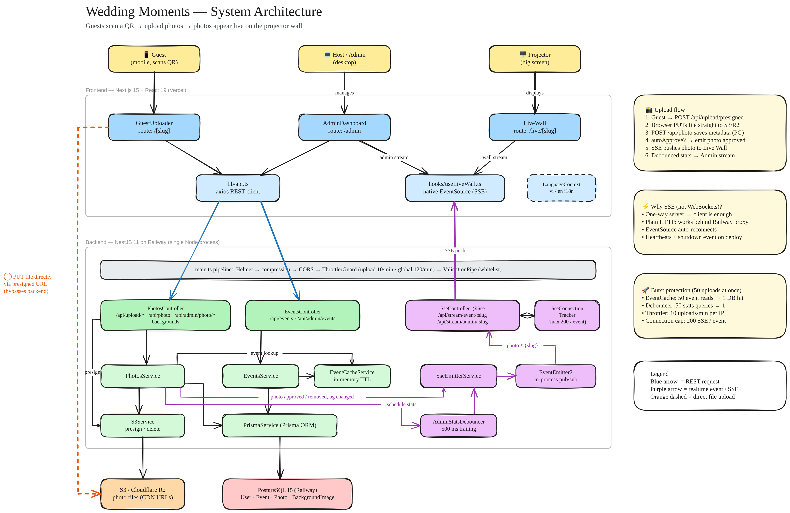

# Wedding Moments

Real-time event photo sharing. Guests scan a QR code and upload photos, and the photos appear live on a projector "Live Wall".



> Editable diagram: [`docs/architecture.excalidraw`](docs/architecture.excalidraw) (open it at excalidraw.com).
> Full design doc: [`docs/system-design.md`](docs/system-design.md)

## Repository layout

```
wedding-moments/
├── apps/
│   ├── backend/        @wedding-moments/backend   NestJS 11 + Prisma  → Railway (Docker)
│   └── frontend/       @wedding-moments/frontend  Next.js 16 + React 19 → Vercel
├── packages/
│   └── shared/         @wedding-moments/shared    API + SSE contract (types only)
├── docs/               architecture diagram + system design
├── turbo.json          task pipeline (build order, caching, env)
└── package.json        npm workspaces root (single package-lock.json)
```

How the pieces depend on each other:

```
            ┌───────────────────────┐
            │ packages/shared       │  types: Photo, Event, DTO requests,
            │ (built to dist/)      │  LiveWallSseMessage, AdminSseMessage …
            └─────────┬─────────────┘
          imports     │      imports
        ┌─────────────┴─────────────┐
        ▼                           ▼
 apps/frontend                 apps/backend
 lib/types.ts re-exports       DTO classes `implements` the request types,
 SSE hooks parse typed msgs    SseController checks message names
```

If someone changes a shape in `packages/shared`, any app that is out of date **fails to compile** instead of breaking at runtime.

## Getting started

Requires Node 22+.

```bash
npm install
```

`npm install` (run at the repo root) installs every workspace and also runs `prisma generate` for the backend.

```bash
npm run dev
```

This starts the backend (http://localhost:4000) and frontend (http://localhost:3000) together. To run only one:

```bash
npm run dev:backend
```

```bash
npm run dev:frontend
```

Environment files stay where they were: `apps/backend/.env` and `apps/frontend/.env.local`.

## Common commands (run from the root)

| Command | What it does |
|---|---|
| `npm run build` | Builds `shared` first, then both apps (in parallel, cached) |
| `npm run typecheck` | `tsc --noEmit` in every workspace |
| `npm run lint` | ESLint in every workspace |
| `npm run test` | Jest (backend) |
| `npx turbo run build --filter=@wedding-moments/backend` | Build one app plus whatever it depends on |
| `npm install <pkg> -w @wedding-moments/frontend` | Add a dependency to one app |

Turborepo caches task results. Re-running a task whose inputs haven't changed takes milliseconds (`>>> FULL TURBO`).

## Environment variables and Turborepo

Turborepo runs tasks in **strict env mode**, so a task only sees the environment variables listed in `turbo.json`. If you add a new env var that is read at **build time** (for example in `next.config.ts` or a `NEXT_PUBLIC_*` value), add it to `tasks.build.env`. If it's read by `npm run dev`, add it to `tasks.dev.passThroughEnv`. If you skip this, the variable is silently `undefined`.

## Deployment

### Frontend: Vercel
In the Vercel project settings:
- **Root Directory**: `apps/frontend`
- Install and build commands come from [`apps/frontend/vercel.json`](apps/frontend/vercel.json). They install from the repo root and build `shared` → `frontend` through Turborepo.
- Env vars are unchanged (`NEXT_PUBLIC_API_URL`, `NEXT_PUBLIC_MEDIA_CDN_URL`, …).

### Backend: Railway (Docker)
The backend now needs `packages/shared`, so the Docker **build context must be the repo root**:

```bash
docker build -f apps/backend/Dockerfile -t wedding-moments-backend .
```

In Railway service settings:
- **Root Directory**: leave empty (repo root)
- Variable `RAILWAY_DOCKERFILE_PATH` = `apps/backend/Dockerfile`
- **Watch Paths** (optional, avoids redeploys on frontend-only commits): `apps/backend/**`, `packages/shared/**`
- Env vars are unchanged (`DATABASE_URL`, `AWS_*`, `S3_BUCKET_NAME`, `ALLOWED_ORIGINS`, …).

## History

This repo merges `wedding-moments-be` and `wedding-moments-fe` with their **full git history**. Each repo's history was rewritten into its subfolder before the merge, so a plain path query reaches back to the very first commit:

```bash
git log -- apps/backend/src/main.ts
```
