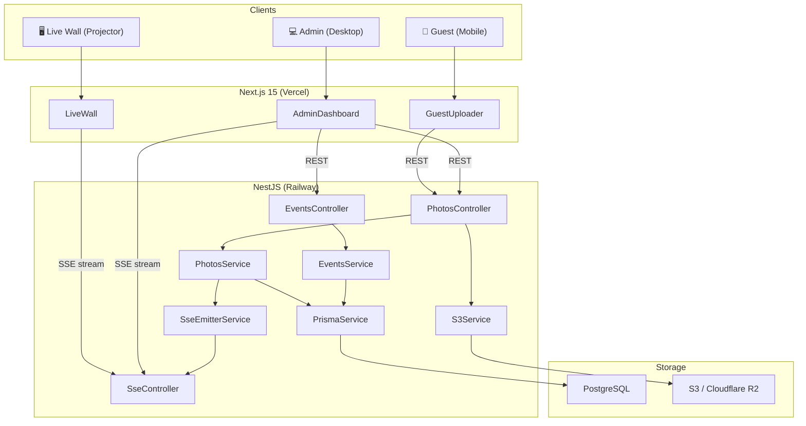
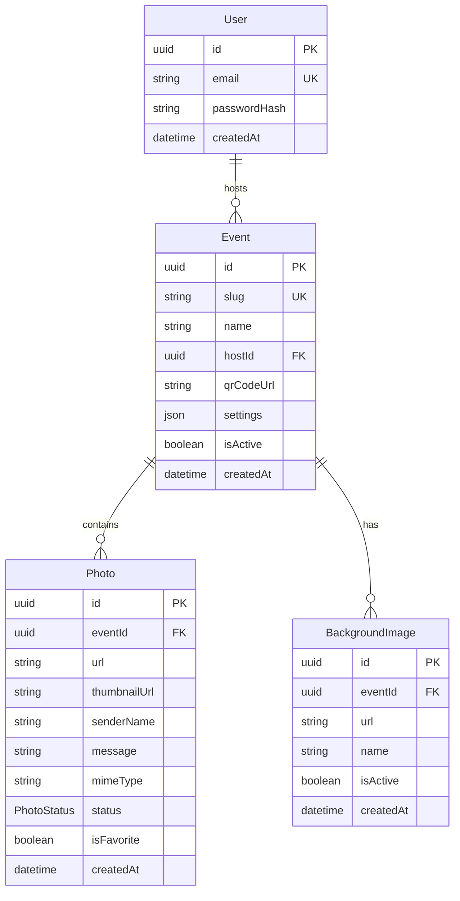
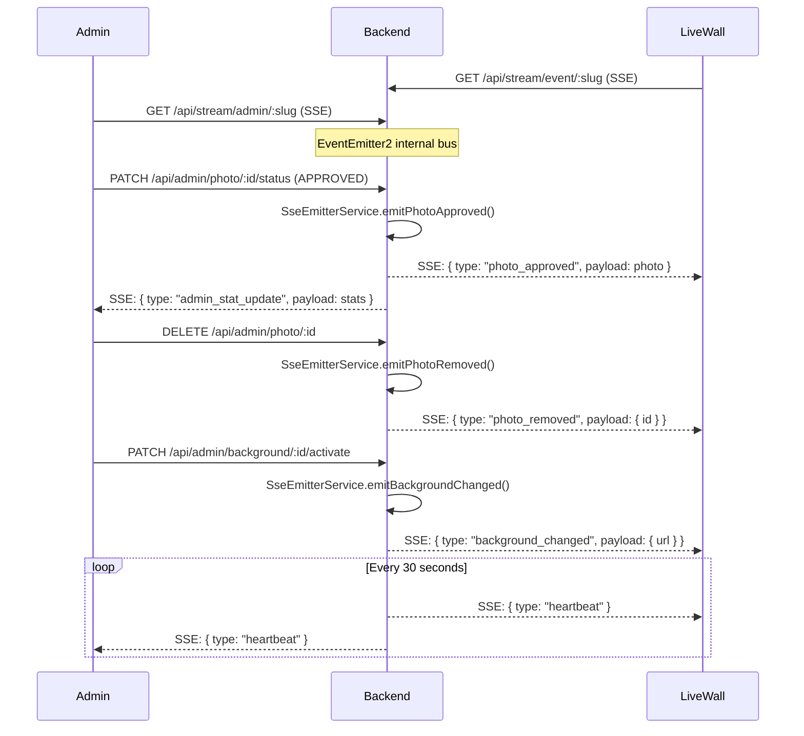
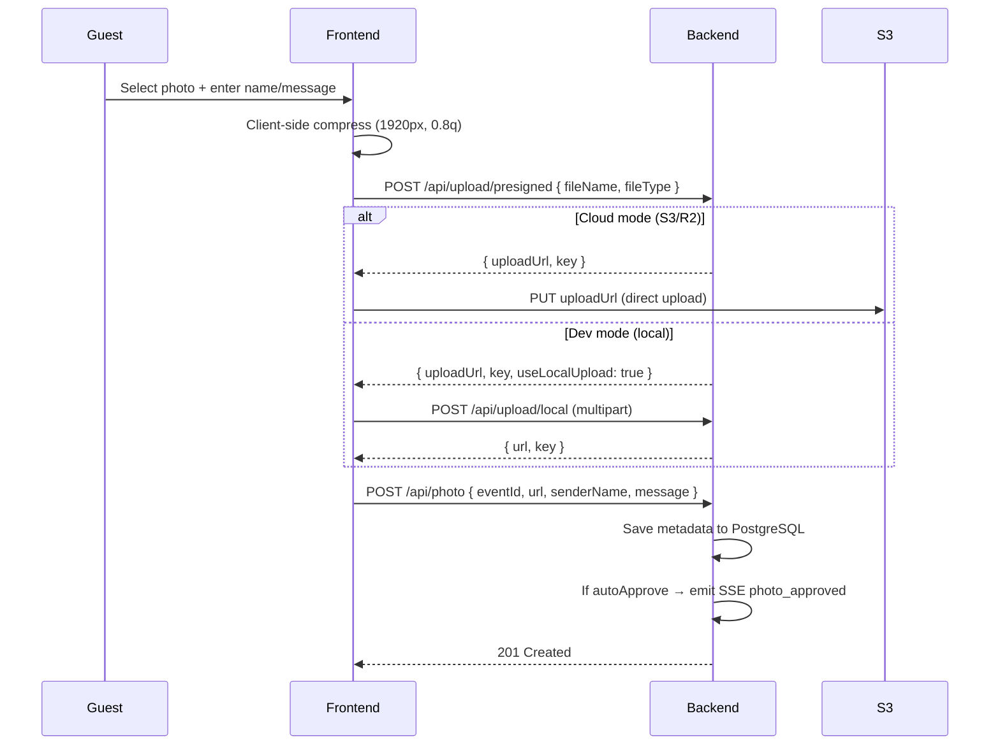
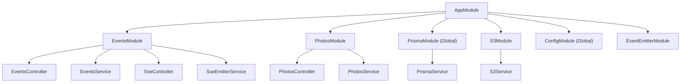

# Wedding Memos — System Design Document (SDD)

> A real-time event photo-sharing platform. Guests scan a QR code, upload photos, and the host sees them appear on a cinematic Live Wall projected on a big screen.

---

## 1. High-Level Architecture



### Deployment Topology

| Layer | Technology | Hosting | URL Pattern |
|-------|-----------|---------|-------------|
| Frontend | Next.js 15 + React 19 | Vercel | `wedding-moments-fe.vercel.app` |
| Backend | NestJS + Express | Railway | `*.up.railway.app` |
| Database | PostgreSQL 15 | Railway | Internal service |
| Object Storage | S3-compatible (AWS S3 or Cloudflare R2) | AWS / Cloudflare | CDN URLs |

---

## 2. Data Model (Prisma)



### Enums

| Enum | Values | Usage |
|------|--------|-------|
| `PhotoStatus` | `PENDING`, `APPROVED`, `REJECTED` | Controls visibility on the Live Wall |

### Key Schema Details

- **`Event.settings`** — JSONB column storing `{ autoApprove: boolean, theme: string }`. Default: `{ autoApprove: true, theme: "dark" }`.
- **`BackgroundImage.isActive`** — Only one background per event can be active at a time (enforced in application logic).
- All foreign keys use `onDelete: Cascade` — deleting an event removes all its photos and backgrounds.

---

## 3. REST API Contract

All endpoints are prefixed with `/api`.

### 3.1 Events

| Method | Path | Auth | DTO / Body | Description |
|--------|------|------|-----------|-------------|
| `GET` | `/events/:slug` | Public | — | Find event by slug |
| `POST` | `/events` | Public | `CreateEventDto` | Create event (programmatic) |
| `GET` | `/admin/events` | Admin | — | List all events |
| `POST` | `/admin/events` | Admin | `{ name, slug }` | Create event from dashboard |
| `PATCH` | `/admin/events/:slug` | Admin | `{ name }` | Rename event |
| `DELETE` | `/admin/events/:slug` | Admin | — | Delete event + cascade |

### 3.2 Photos

| Method | Path | Auth | DTO / Body | Description |
|--------|------|------|-----------|-------------|
| `POST` | `/upload/presigned` | Public | `GetPresignedUrlDto` | Get presigned S3 URL (or local URL in dev) |
| `POST` | `/upload/local` | Public | `multipart/form-data` | Dev-mode local upload |
| `POST` | `/photo` | Public | `CreatePhotoDto` | Save photo metadata post-upload |
| `GET` | `/event/:slug/photos` | Public | — | Approved photos for Live Wall |
| `GET` | `/admin/event/:slug/photos` | Admin | — | All photos (any status) |
| `GET` | `/admin/event/:slug/stats` | Admin | — | `{ totalPhotos, pendingCount }` |
| `PATCH` | `/admin/photo/:id/status` | Admin | `UpdatePhotoStatusDto` | Approve or reject |
| `DELETE` | `/admin/photo/:id` | Admin | — | Permanent delete |

### 3.3 Background Images

| Method | Path | Auth | Body | Description |
|--------|------|------|------|-------------|
| `POST` | `/admin/event/:slug/background` | Admin | `{ url, name? }` | Add background |
| `GET` | `/admin/event/:slug/backgrounds` | Admin | — | List backgrounds |
| `PATCH` | `/admin/background/:id/activate` | Admin | — | Set as active |
| `PATCH` | `/admin/event/:slug/background/deactivate` | Admin | — | Revert to default |
| `DELETE` | `/admin/background/:id` | Admin | — | Delete background |
| `GET` | `/event/:slug/active-background` | Public | — | Get active background URL |

### 3.4 DTOs (class-validator)

```typescript
// Upload
GetPresignedUrlDto    { fileName: string, fileType: string }

// Photos
CreatePhotoDto        { eventId, url, senderName?, message?, mimeType? }
UpdatePhotoStatusDto  { status: PhotoStatus }

// Events
CreateEventDto        { name, slug, hostId }
```

The backend uses a global `ValidationPipe` with `whitelist: true` and `forbidNonWhitelisted: true`.

---

## 4. Real-Time Communication (SSE)

The system uses **Server-Sent Events** (replaced WebSockets/Socket.io for Railway compatibility).

### Architecture



### SSE Endpoints

| Endpoint | Audience | Event Types |
|----------|----------|-------------|
| `/api/stream/event/:slug` | Live Wall | `photo_approved`, `photo_removed`, `background_changed`, `heartbeat` |
| `/api/stream/admin/:slug` | Admin Dashboard | `admin_stat_update`, `photo_approved`, `heartbeat` |

### Backend Implementation

- **`SseEmitterService`** — Wraps `EventEmitter2` to emit typed events: `photo.approved.{slug}`, `photo.removed.{slug}`, `background.changed.{slug}`, `admin.stats.{slug}`.
- **`SseController`** — Uses NestJS `@Sse()` decorator. Creates RxJS `Observable<MessageEvent>` by merging `fromEvent()` observables + a 30s heartbeat interval.

### Frontend Implementation (`useLiveWall.ts`)

- Creates a native `EventSource` connection to `/api/stream/event/:slug`
- Reconnects automatically on error with a 3-second delay
- Parses SSE `data` field as JSON and dispatches to callbacks: `onPhotoApproved`, `onPhotoRemoved`, `onBackgroundChanged`
- Returns `{ isConnected }` state for the status indicator dot

---

## 5. Upload Flow



### Storage Provider Abstraction

The backend uses a `StorageProvider` interface with two implementations:
- **`S3StorageProvider`** — AWS S3
- **`R2StorageProvider`** — Cloudflare R2

Selected via the `STORAGE_PROVIDER` env var in `StorageModule`.

---

## 6. Frontend Architecture

### Tech Stack

| Concern | Technology |
|---------|-----------|
| Framework | Next.js 15 (App Router) |
| UI Library | React 19 |
| Styling | Tailwind CSS + shadcn/ui components |
| Animations | Framer Motion |
| Font | Montserrat (latin + vietnamese) |
| Toast Notifications | Sonner |
| QR Codes | `qrcode.react` |
| Dropzone | `react-dropzone` |
| State Management | React hooks (useState, useCallback, useMemo) |

### Route Structure

| Route | Component | Description |
|-------|-----------|-------------|
| `/` | Landing page | Links to admin dashboard |
| `/[slug]` | `GuestUploader` | Dynamic guest upload page per event |
| `/[slug]/wall` | `LiveWall` | Real-time photo slideshow (projector) |
| `/admin` | `AdminDashboard` | Event management + photo moderation |

### Component Tree

```
RootLayout (layout.tsx)
├── Providers (LanguageProvider + Toaster)
│   ├── GuestUploader   — File drop/upload with progress
│   ├── LiveWall        — Cinematic slideshow + parallax constellation
│   │   └── useLiveWall — SSE hook for real-time updates
│   ├── AdminDashboard  — Event CRUD + photo moderation
│   ├── QRCodeModal     — QR display + print functionality
│   └── LanguageToggle  — VI/EN language switcher
```

### Live Wall Visual System

The Live Wall has three visual states:

1. **Loading** — Pulsing icon + "Entering Live Wall" label
2. **Empty** — Gradient background + QR code invitation
3. **Active** — Three-layer parallax depth system:
   - **Background layer** — 18 orbit slots with blur, drift, and opacity per depth tier (foreground/midground/background)
   - **Vignette** — Radial gradient drawing eye to center
   - **Hero layer** — Center photo with glassmorphic frame, cinematic enter/exit transitions (1.2s spring easing), message typography

Photo cycle interval: **8 seconds**.

---

## 7. Internationalization (i18n)

### Architecture

- **`LanguageContext`** — React Context providing `{ language, setLanguage, t }` to the entire app
- **Translation files** — `i18n/vi.ts` and `i18n/en.ts` with identical key sets
- **Default language** — Vietnamese (`vi`)
- **Language toggle** — `LanguageToggle` component with animated dropdown (Framer Motion)
- **Persistence** — `localStorage` key `'preferred-language'`

### Coverage

All user-facing strings in: `GuestUploader`, `LiveWall`, `AdminDashboard`, `QRCodeModal`, and `LanguageToggle`.

---

## 8. Backend Module Structure



### Key Services

| Service | Responsibility |
|---------|---------------|
| `PrismaService` | Database access, lifecycle hooks (`onModuleInit`) |
| `EventsService` | Event CRUD, slug lookup |
| `PhotosService` | Photo CRUD, status transitions, background management, SSE emission |
| `S3Service` | Presigned URL generation, object operations |
| `SseEmitterService` | Internal event bus → SSE bridge |

---

## 9. Configuration & Environment

| Variable | Purpose | Default |
|----------|---------|---------|
| `DATABASE_URL` | PostgreSQL connection | — |
| `PORT` | Backend port | `4000` |
| `AWS_ACCESS_KEY_ID` | S3 credentials | — |
| `AWS_SECRET_ACCESS_KEY` | S3 credentials | — |
| `AWS_S3_BUCKET` | Bucket name | — |
| `AWS_REGION` | S3 region | — |
| `STORAGE_PROVIDER` | `s3` or `r2` | `s3` |
| `BACKEND_URL` | Public backend URL | `http://localhost:4000` |
| `NEXT_PUBLIC_API_URL` | Frontend → Backend URL | `http://localhost:4000` |

### Dev vs Prod Storage

The `PhotosController` auto-detects dev mode: if `AWS_ACCESS_KEY_ID` is empty or `"your-access-key"`, it falls back to local disk storage at `./public/uploads`.

---

## 10. Infrastructure

### Docker Compose (Development)

```yaml
services:
  db:        # PostgreSQL 15 on port 5432
  backend:   # NestJS on port 4000, depends on db
  frontend:  # Next.js on port 3000
```

### CORS Configuration

Allowed origins (hardcoded in `main.ts`):
- `http://localhost:3000`, `http://localhost:3001`
- `http://192.168.1.8:3000` (LAN testing)
- `https://wedding-moments-fe.vercel.app`
- Production Vercel preview URLs

### Global Middleware

- **`ValidationPipe`** — DTO validation with whitelist + forbidNonWhitelisted
- **CORS** — Credentials enabled
- **Static assets** — Served from `./public/uploads` at `/uploads/`

---

## 11. Security Considerations

> [!WARNING]
> The current system has **no authentication** on admin endpoints. All `/api/admin/*` routes are publicly accessible. This is acceptable for a private event tool but must be addressed before any public deployment.

### Current Gaps

| Gap | Risk | Mitigation Path |
|-----|------|-----------------|
| No admin auth | Anyone can moderate | Add JWT/session auth to admin routes |
| No rate limiting | Upload spam | Add `@nestjs/throttler` |
| No file type validation (backend) | Malicious uploads | Validate MIME types server-side |
| Hardcoded CORS origins | Inflexible | Move to env-based origin list |
| No HTTPS enforcement | MitM attacks | Already handled by Vercel/Railway hosting |

---

## 12. Performance Characteristics

| Metric | Value | Notes |
|--------|-------|-------|
| Live Wall cycle | 8s per photo | Configurable in `LiveWall.tsx` |
| SSE heartbeat | 30s | Keeps Railway proxy alive |
| SSE reconnect | 3s delay | In `useLiveWall.ts` |
| Max photos in memory | 50 | Frontend caps for DOM performance |
| Client compression | 1920px / 0.8q | Reduces upload size ~70% |
| Upload size limit | 50MB | Multer config for local uploads |
| Parallax orbit slots | 18 | Three depth tiers in Live Wall |

---

## 13. Completed Feature Tracks

| Feature | Status | Key Files |
|---------|--------|-----------|
| Core upload + display pipeline | ✅ | `GuestUploader.tsx`, `PhotosController`, `LiveWall.tsx` |
| SSE real-time push (replaced WebSockets) | ✅ | `SseController`, `SseEmitterService`, `useLiveWall.ts` |
| Event management CRUD | ✅ | `EventsController`, `AdminDashboard.tsx` |
| Dynamic routing per event | ✅ | `app/[slug]/page.tsx`, `app/[slug]/wall/page.tsx` |
| Background image management | ✅ | `PhotosController` (background endpoints) |
| Multi-cloud storage (S3 + R2) | ✅ | `StorageModule`, `S3Service` |
| Multilingual UI (VI/EN) | ✅ | `LanguageContext`, `i18n/vi.ts`, `i18n/en.ts` |
| Client-side image compression | ✅ | `GuestUploader.tsx` |
| Cinematic Live Wall with parallax | ✅ | `LiveWall.tsx` (18-slot orbit system) |
| QR code generation + print | ✅ | `QRCodeModal.tsx` |
